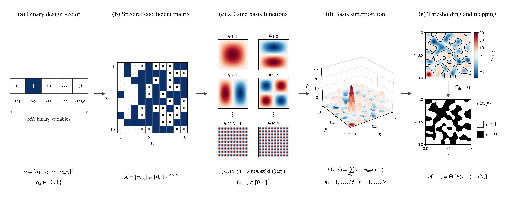

<h1>90° 矽光子彎曲波導 結構反向設計與 FDTD 模擬教學</h1>

  <strong>
    使用 Meep 有限差分時域法（FDTD）評估彎曲波導的 TE₀ 模態傳輸， 
    並比較 2D Fourier Basis、Gaussian Upsampling 與 β-VAE 三種結構編碼方法。
  </strong>

  <a href="#概述">概述</a> ·
  <a href="#主要內容">主要內容</a> ·
  <a href="#方法">方法</a> ·
  <a href="#模擬設定">模擬設定</a> ·
  <a href="#結果">結果</a> ·
  <a href="#教學">教學</a> ·
  <a href="#執行方式">執行方式</a> ·
  <a href="#引用">引用</a>

  
  
  
  
  

## 概述

彎曲波導是矽光子積體電路（Silicon Photonics Integrated Circuits）中常見的被動光學元件，主要功能是改變光訊號的傳播方向。彎曲區域的幾何形狀會影響導波模態的侷限程度、輻射損耗及輸出端的模態傳輸，因此如何在有限的設計區域內找到具有良好傳輸特性的結構，是矽光子元件設計的重要課題。

本專案以 Meep 開源電磁模擬套件進行有限差分時域法（Finite-Difference Time-Domain, FDTD）模擬，建立輸入波導位於 **−X 側、光沿 +X 方向入射**，並由輸出波導沿 +Y 方向導出的 90° 彎曲波導模型。設計區域位於中央，透過 TE₀ 模態激發與模態係數監測，評估候選結構的穿透率。

為了探索不同的結構表示方式，本專案實作三種編碼方法：**2D Fourier Basis、Gaussian Upsampling（GU）及 β-Variational Autoencoder（β-VAE）**。各方法將低維度的最佳化變數轉換成 Meep 可用的材料分佈，再由電磁模擬計算穿透率。

最佳化流程以因子分解機（Factorization Machine, FM）建立代理模型，將模型轉換為二次無約束二元最佳化（Quadratic Unconstrained Binary Optimization, QUBO）問題，並使用模擬退火（Simulated Annealing, SA）搜尋候選解。部分程式亦保留 D-Wave 量子退火（Quantum Annealing, QA）的介面。

> **注意：** 本專案目前採用二維（2D）Meep 模型，材料區域在垂直於模擬平面的方向視為無限延伸（mp.inf）。因此，結果屬於二維模型下的數值模擬，不應直接視為具有有限矽核心厚度的完整 3D SOI 元件結果；本專案亦未進行實際元件製作或量測。

## 主要內容

- **90° 彎曲波導 FDTD 模型：** 建立中央 4 µm × 4 µm 的設計區域，搭配左右／上下延伸的固定波導臂，以 Meep 評估 TE₀ 模態的輸入與輸出功率。
- **三種結構編碼方法：** 分別以 Fourier 基底、Gaussian 平滑與投影，以及 β-VAE 潛在空間表示設計結構，提供不同的設計空間參數化方式。
- **FM-QUBO 最佳化流程：** 利用已完成 FDTD 評估的樣本訓練 FM 代理模型，轉換成 QUBO 後以 SA 搜尋新候選解，再由 Meep 進行真實物理評估。
- **MPI 平行模擬：** 使用 MPI 將不同候選結構的 FDTD 工作分派給多個 Worker，降低大量候選結構評估所需的時間。
- **Notebook 與 Python 程式：** 每種編碼方法均提供 Jupyter Notebook 與可透過命令列執行的 Python 程式。

## 方法

### 1. 整體最佳化流程

本專案的三種編碼方法具有不同的結構表示方式，但都以 Meep FDTD 模擬作為候選結構的物理評估工具。整體流程如下：

~~~mermaid
flowchart TD
    A["產生初始設計變數"] --> B["結構編碼與幾何解碼"]
    B --> C["Meep FDTD 模擬"]
    C --> D["計算 TE₀ 模態穿透率"]
    D --> E["建立並更新訓練資料集"]
    E --> F["訓練 Factorization Machine"]
    F --> G["轉換為 QUBO"]
    G --> H["SA 搜尋候選解"]
    H --> B
    D --> I["最佳結構與結果分析"]
~~~

每一輪最佳化中，FM 會根據目前已評估的設計樣本學習設計變數與穿透率之間的關係。模型參數可轉換為 QUBO，交由 SA 搜尋低能量候選解。候選解經結構解碼後，再由 Meep 執行 FDTD 模擬，將新的穿透率資料加入資料集，供下一輪代理模型訓練使用。

本專案以 **提高 TE₀ 模態穿透率**為目標。程式內部依不同實作使用穿透率或其負值作為最佳化目標，閱讀各程式時應以實際的 FOM 定義為準。

### 2. 2D Fourier Basis

**核心概念：以一組二維 Fourier 正弦基底的啟用組合，直接表示設計區域。**

本方法將設計區域切分為 (10 \times 10) 組 Fourier modes，每個 mode 對應一個二元變數，共 **100 個設計變數**。當某個係數為 1 時，便將對應的正弦基底加入重建場：

$
S(x,y)=\sum_{m=1}^{10}\sum_{n=1}^{10}
\alpha_{mn}\sin(m\pi x)\sin(n\pi y),
\qquad \alpha_{mn}\in\{0,1\}.
$

所有啟用的基底相加後，以 (S(x,y)>0) 為門檻轉成二元材料分佈，再映射到 Meep 的 MaterialGrid。這種表示方式以少量頻域係數控制較高解析度的幾何結構，設計變數不是直接對應每一個 FDTD 網格像素。

**目前程式設定：** 10 × 10 modes、100 個二元變數；初始資料集 1,000 筆，每輪新增 30 個候選結構，共執行 100 輪。程式輸出最佳結構、Ez 場分佈、FoM 歷程及最佳化軌跡。

程式位置：

- [2D_Fourier_10x10.ipynb](Tutorial/2D_Fourier_Basis/2D_Fourier_10x10.ipynb)
- [2D_Fourier_10x10.py](Tutorial/2D_Fourier_Basis/2D_Fourier_10x10.py)

### 3. Gaussian Upsampling（GU）

**核心概念：先以低解析度二元網格決定材料分佈，再透過 Gaussian convolution 與 Tanh projection 平滑結構。**

GU 直接以 (10 \times 10) 二元網格作為設計變數，共 **100 個二元變數**。解碼時先使用 (5 \times 5)、標準差 $\\sigma=1.0$ 的 Gaussian kernel 對網格做卷積，得到連續密度分佈；接著使用 Tanh projection 將密度推向接近 0 或 1 的區域：

[
\tilde{\rho}=\operatorname{GaussianFilter}(\rho), 
\qquad
\rho_{p}=\operatorname{TanhProjection}(\tilde{\rho};\beta=50,\eta=0.5).
$

投影後的密度會映射至 Meep MaterialGrid，並設定 smoothing radius。相較於直接以像素表示結構，GU 讓相鄰設計變數之間具有平滑關聯，有助於降低過度零碎的材料邊界。

**目前程式設定：** 10 × 10 網格、100 個二元變數；Gaussian kernel 為 5 × 5、$\\sigma=1.0$，Tanh projection 使用 (eta=50)、$\\eta=0.5$。初始資料集 1,000 筆，每輪新增 30 個候選結構，共執行 100 輪。

程式位置：

- [WG_GU_1000_10x10.ipynb](Tutorial/Gaussian_Upsampling/WG_GU_1000_10x10.ipynb)
- [WG_GU_1000_10x10.py](Tutorial/Gaussian_Upsampling/WG_GU_1000_10x10.py)

### 4. β-Variational Autoencoder（β-VAE）

**核心概念：先讓生成式模型學習結構分佈，再於低維潛在空間中搜尋設計變數。**

β-VAE 先產生 **10,000 組 64 × 64 合成二元結構**作為訓練資料。Encoder 使用卷積層將輸入結構壓縮成潛在分佈；每個潛在維度採用 2 類別的 categorical representation，並透過 Gumbel-Softmax 進行可微分取樣。Decoder 再將潛在表示還原成 64 × 64 結構。

目前程式設定為 **100 個 categorical latent variables，每個變數有 2 個類別**，因此最佳化時以 100 個二元選擇描述潛在表示。Decoder 輸出會再經過 (5 \times 5)、$\\sigma=1.0$ 的 Gaussian smoothing，以及 (eta=30)、$\\eta=0.5$ 的 Tanh projection，最後以 0.5 為門檻二值化後交由 Meep 評估。VAE 訓練損失中的 KL 項權重設為 0.01。

**目前程式設定：** 輸入／輸出結構為 64 × 64、100 個二元潛在變數、10,000 組合成訓練樣本、30 epochs；最佳化階段使用 2,000 筆初始模擬資料，每輪新增 30 個候選結構，共執行 200 輪。與 Fourier 和 GU 相比，β-VAE 的結構表示經過額外的生成模型訓練，搜尋變數代表潛在空間的選擇，而不是直接對應 64 × 64 像素。

程式位置：

- [bVAE_gu.ipynb](Tutorial/beta_VAE/bVAE_gu.ipynb)
- [bVAE_gu.py](Tutorial/beta_VAE/bVAE_gu.py)

## 模擬設定

以下參數整理自目前三種 Python 程式共用的 Meep 模型設定。

| 參數 | 數值 | 說明 |
|---|---:|---|
| 模擬維度 | 2D | 二維 FDTD 模型 |
| 設計區域 | 4.0 × 4.0 µm² | 中央可最佳化區域 |
| WG_WIDTH | 0.5 µm | 輸入與輸出波導寬度 |
| WG_LENGTH | 1.0 µm | 固定波導臂長度參數 |
| DPML | 1.0 µm | PML 吸收層厚度 |
| SX、SY | 8.0 µm | 模擬計算區域尺寸 |
| N_SI | 3.48 | 矽材料折射率 |
| N_SIO2 | 1.44 | 二氧化矽材料折射率 |
| WL_CEN | 1.55 µm | 中心波長 |
| FCEN | 1 / 1.55 | 中心頻率 |
| DF | 0.1 × FCEN | Gaussian source 頻寬參數 |
| NFREQ | 1 | 模態監測頻率點數 |
| RESOLUTION | 40 | 每 µm 的網格數 |

長度單位為 µm。上述折射率採用常數近似，未包含材料色散模型。模擬中以 EigenModeSource 激發輸入導波模態，並透過模態監測器取得輸入與輸出端的模態係數。程式以 Ez 場分量作為主要場分佈與衰減觀察量；TE₀ 的偏振命名應搭配本專案的二維模擬平面及場分量慣例理解。

### 最佳化參數

下表為各程式目前的預設參數，主要供重現與比較程式設定使用；不同方法的資料量、設計變數定義與模型訓練流程並不完全相同，因此不應只憑表格中的數字直接判定方法優劣。

<b>2D Fourier Basis 設定</b>（點擊展開）

| 類別 | 參數 | 數值 |
|---|---|---:|
| 設計空間 | Fourier modes | 10 × 10 |
| 設計空間 | 二元變數數量 | 100 |
| 初始資料集 | 樣本數 | 1,000 |
| 最佳化 | 迭代次數 | 100 |
| 最佳化 | 每輪新增候選數 | 30 |
| FM 代理模型 | 因數維度 K | 10 |
| FM 代理模型 | 訓練 epochs | 1,000 |
| FM 代理模型 | Learning rate | 0.001 |
| SA | num_reads | 10,000 |
| SA | num_sweeps | 1,000 |
| 預設取樣器 | SAMPLER_TYPE | SA |

<b>Gaussian Upsampling 設定</b>（點擊展開）

| 類別 | 參數 | 數值 |
|---|---|---:|
| 設計空間 | 二元網格 | 10 × 10 |
| 設計空間 | 二元變數數量 | 100 |
| Gaussian kernel | Kernel size | 5 × 5 |
| Gaussian kernel | 標準差 σ | 1.0 |
| Tanh projection | β | 50 |
| Tanh projection | η | 0.5 |
| 初始資料集 | 樣本數 | 1,000 |
| 最佳化 | 迭代次數 | 100 |
| 最佳化 | 每輪新增候選數 | 30 |
| FM 代理模型 | 因數維度 K | 8 |
| FM 代理模型 | 訓練 epochs | 1,000 |
| FM 代理模型 | Learning rate | 0.001 |
| SA | num_reads | 1,500 |
| SA | num_sweeps | 1,000 |
| 預設取樣器 | SAMPLER_TYPE | SA |

<b>β-VAE 設定</b>（點擊展開）

| 類別 | 參數 | 數值 |
|---|---|---:|
| 輸入結構 | 影像尺寸 | 64 × 64 |
| VAE | 隱藏層 | 512、256 |
| VAE | 潛在變數數量 N | 100 |
| VAE | 每個潛在變數類別數 K | 2 |
| VAE 訓練 | 合成資料數量 | 10,000 |
| VAE 訓練 | Batch size | 64 |
| VAE 訓練 | Epochs | 30 |
| VAE 訓練 | Learning rate | 0.001 |
| 初始模擬資料 | 樣本數 | 2,000 |
| 最佳化 | 迭代次數 | 200 |
| 最佳化 | 每輪新增候選數 | 30 |
| FM 代理模型 | 因數維度 K | 10 |
| FM 代理模型 | 訓練 epochs | 1,000 |
| SA | num_reads | 2,000 |
| SA | num_sweeps | 1,000 |

## 結果

三種 encoding 都以相同類型的 90° 彎曲波導與 TE₀ 模態傳輸率作為評估目標，但設計變數的定義、搜尋空間與評估預算不同。根據目前整理的實驗紀錄，代表性最佳傳輸率如下：

| Encoding | 代表性設計設定 | FDTD 評估樣本數 | 代表性最佳傳輸率 |
|---|---:|---:|---:|
| 2D Fourier Basis | 10 × 10 Fourier modes | 約 4,000 | **99.30%** |
| Gaussian Upsampling | 12 × 12 binary grid | 約 4,000 | **95.6%** |
| β-VAE | 12 × 12 latent representation | 約 8,000 | **91.0%** |

> **結果解讀：** 上表列出的是目前實驗紀錄中的 best-found transmission，不代表全域最佳解，也不保證每次重新執行都會得到相同數值。三組結果使用的設計維度與 FDTD 評估預算並不完全相同，因此適合作為各方法目前成果的摘要，不應直接解讀為嚴格控制變因下的效能排名。Repository 中 Python 程式的預設參數以各方法章節及程式碼為準；表格中的 GU 與 β-VAE 數值是不同網格設定下的實驗紀錄。

從方法特性來看，Fourier Basis 以預先定義的空間頻率基底組合表示結構；GU 直接搜尋低解析度二元網格，再以 Gaussian smoothing 和 Tanh projection 建立較平滑的材料分佈；β-VAE 則先學習合成結構的分佈，再透過潛在變數控制 Decoder 生成高解析度結構。三種方法提供不同的設計空間限制與結構先驗。

目前程式會輸出各自的最佳結構、場分佈與最佳化歷程。比較不同方法時，建議統一 Meep 模擬區域、材料折射率、波導尺寸、中心波長、模態監測方式及 FDTD resolution；若要比較收斂速度，應以**累積 FDTD 評估次數**作為共同橫軸，而不只比較迭代輪數。

**所有結果皆為 Meep 二維 FDTD 數值模擬結果，並非實際元件量測。** SA 與初始樣本具有隨機性，且退火搜尋不保證找到全域最佳解。本文所稱的最佳結構，應理解為該次實驗中已評估樣本的最佳解（best-found solution）。

### README 圖片素材清單

建議在本機 Repository 根目錄自行建立 `assets/`，將以下圖片放入其中。README 使用相對路徑 `assets/檔名.png`；目前 GitHub Repository 尚未包含這個資料夾，等圖片準備好後再一起 commit 即可。

**建議準備 12 張主要圖片：**

| 類別 | 建議檔名 | 圖片內容 | 可使用的程式輸出／製作方式 |
|---|---|---|---|
| 共用幾何 | `bend_geometry.png` | 90° 彎曲波導、4 × 4 µm² 設計區域、輸入／輸出方向與 PML | 依 Meep 幾何參數繪製示意圖 |
| Fourier 編碼 | `fourier_encoding.png` | 10 × 10 Fourier coefficient、基底疊加、閾值二值化的編碼流程 | 由 Fourier Notebook 擷取並整理成流程圖 |
| Fourier 結構 | `best_structure_fourier.png` | Fourier 最佳化後的二元材料結構 | 複製 Fourier 結果資料夾中的 `Smoothed_Binary_Structure.png` |
| Fourier 場分佈 | `field_fourier.png` | 最佳結構中的 Ez 場強度與波導邊界 | 複製 `final_analysis_TE0_field.png` |
| GU 編碼 | `gu_encoding.png` | 10 × 10 binary grid → Gaussian convolution → Tanh projection → MaterialGrid | 可將 `best_config_10x10.png` 與編碼流程整合成一張圖 |
| GU 結構 | `best_structure_gu.png` | Gaussian smoothing 與 Tanh projection 後的最佳結構 | 複製 GU 結果資料夾中的 `Smoothed_Binary_Structure.png` |
| GU 場分佈 | `field_gu.png` | 最佳 GU 結構中的 Ez 場強度與波導邊界 | 複製 `Optimized_Final_Structure.png` |
| β-VAE 編碼 | `bvae_encoding.png` | 合成結構資料 → Encoder → 100 個 categorical latent variables → Decoder → 64 × 64 結構 | 依 β-VAE 模型架構繪製流程圖 |
| β-VAE 潛在表示 | `best_latent_bvae.png` | 最佳化找到的 10 × 10 latent representation | 複製 `best_latent_10x10.png` |
| β-VAE 結構 | `best_structure_bvae.png` | Decoder 產生的 64 × 64 最佳二元結構 | 由 `best_structure_64x64.npy` 使用 Matplotlib 繪製；目前程式只儲存 NPY，沒有直接輸出 PNG |
| β-VAE 場分佈 | `field_bvae.png` | 最佳 β-VAE 結構中的 Ez 場強度與波導邊界 | 複製 `final_field.png` |
| 綜合結果 | `fom_comparison.png` | 三種方法的最佳 FoM／傳輸率收斂曲線 | 從各自結果資料夾的 `fom_evolution.png` 整理成同一張圖；橫軸建議統一為累積 FDTD 評估次數 |

**如果希望先完成精簡版首頁，優先做這 8 張：** `bend_geometry.png`、三張編碼流程圖、三張場分佈圖，以及 `fom_comparison.png`。最佳結構圖與 β-VAE 潛在表示圖可接著補上。

**可選擴充圖片：** `optimization_flow.png`（整體 FM–QUBO–SA 流程，README 已有 Mermaid 版本）、`trajectory_comparison.png`（候選樣本傳輸率分佈）、`runtime_comparison.png`（FM 訓練、SA 與 FDTD 時間比較）。若要使用這些跨方法比較圖，請先確認統計定義及模擬預算一致。

圖片完成後，再於對應方法章節加入圖片引用，例如：

~~~markdown

  
   <em>圖：以 Fourier 基底係數組合表示彎曲波導設計區域。</em>

~~~

結果圖建議使用 PNG，架構示意圖可使用 SVG 或 PNG；保留原始模擬輸出，不要只保留裁切後的 README 圖片。

## 教學

本 Repository 依照結構編碼方法分成三個獨立的 Tutorial。每個方法皆提供 Jupyter Notebook 與 Python 程式，Notebook 適合逐步閱讀與理解流程，Python 程式則適合透過 MPI 執行完整最佳化。

### 1. 2D Fourier Basis Tutorial

| 檔案 | 說明 |
|---|---|
| [2D_Fourier_10x10.ipynb](Tutorial/2D_Fourier_Basis/2D_Fourier_10x10.ipynb) | Fourier 基底編碼與彎曲波導設計教學 |
| [2D_Fourier_10x10.py](Tutorial/2D_Fourier_Basis/2D_Fourier_10x10.py) | 2D Fourier Basis 最佳化與 Meep 模擬程式 |
| factorization_machine.py | FM 代理模型實作 |

### 2. Gaussian Upsampling Tutorial

| 檔案 | 說明 |
|---|---|
| [WG_GU_1000_10x10.ipynb](Tutorial/Gaussian_Upsampling/WG_GU_1000_10x10.ipynb) | Gaussian Upsampling 結構編碼教學 |
| [WG_GU_1000_10x10.py](Tutorial/Gaussian_Upsampling/WG_GU_1000_10x10.py) | GU 最佳化與 Meep 模擬程式 |
| factorization_machine.py | FM 代理模型實作 |

### 3. β-VAE Tutorial

| 檔案 | 說明 |
|---|---|
| [bVAE_gu.ipynb](Tutorial/beta_VAE/bVAE_gu.ipynb) | β-VAE 結構生成與潛在空間最佳化教學 |
| [bVAE_gu.py](Tutorial/beta_VAE/bVAE_gu.py) | β-VAE 訓練、FM 最佳化與 Meep 模擬程式 |
| factorization_machine.py | FM 代理模型實作 |

### 專案結構

~~~text
Bend_Waveguide_Tutorial/
├── README.md
├── TUTORIAL.md
├── LICENSE
├── Tutorial/
│   ├── 2D_Fourier_Basis/
│   │   ├── 2D_Fourier_10x10.ipynb
│   │   ├── 2D_Fourier_10x10.py
│   │   └── factorization_machine.py
│   ├── Gaussian_Upsampling/
│   │   ├── WG_GU_1000_10x10.ipynb
│   │   ├── WG_GU_1000_10x10.py
│   │   └── factorization_machine.py
│   └── beta_VAE/
│       ├── bVAE_gu.ipynb
│       ├── bVAE_gu.py
│       └── factorization_machine.py
└── shared_modules/
    ├── __init__.py
    ├── factorization_machine.py
    └── meep_utils.py
~~~

## 執行方式

### 環境需求

程式主要使用以下 Python 套件：

| 套件 | 用途 |
|---|---|
| Meep / pymeep | FDTD 電磁模擬 |
| NumPy、SciPy | 數值運算與濾波 |
| Matplotlib | 結構及模擬結果視覺化 |
| PyTorch | FM 與 β-VAE 模型訓練 |
| mpi4py、MPI | 平行分派 FDTD 模擬工作 |
| dimod | 建立 QUBO / Binary Quadratic Model |
| dwave-samplers | 模擬退火取樣 |
| dwave-system | 選用；連接 D-Wave 量子退火器 |

本 Repository 目前未提供固定版本的 requirements.txt 或 Conda environment 檔案。請依照使用環境安裝相容的 Meep、MPI 與 Python 套件版本。Meep 安裝方式請參考官方文件：[Meep Installation Guide](https://meep.readthedocs.io/en/latest/Installation/)。

### 執行 Gaussian Upsampling 範例

在 Repository 根目錄執行：

~~~bash
cd Tutorial/Gaussian_Upsampling
mpirun -np 31 python WG_GU_1000_10x10.py --name bend_gu
~~~

### 執行 2D Fourier Basis 範例

~~~bash
cd Tutorial/2D_Fourier_Basis
mpirun -np 31 python 2D_Fourier_10x10.py --name bend_fourier
~~~

### 執行 β-VAE 範例

~~~bash
cd Tutorial/beta_VAE
mpirun -np 31 python bVAE_gu.py
~~~

上述 -np 31 代表啟動 31 個 MPI processes，通常包含 1 個 Master 與 30 個 Workers。請依照實際 CPU 核心數、記憶體及可用運算資源調整，不應在未評估資源的情況下任意提高行程數。

各程式的結果輸出位置依程式而異，包含 Fourier 的 Results/、GU 的 Results_Bend/，以及 β-VAE 的時間戳記結果資料夾。實際路徑以執行時的工作目錄與程式輸出訊息為準。

更完整的模型說明、執行流程與注意事項，請參閱 [TUTORIAL.md](TUTORIAL.md)。

## 限制與注意事項

1. **二維模型限制：** 目前模型使用 mp.inf 描述垂直於模擬平面的方向，未完整描述有限厚度 SOI 波導的垂直侷限。
2. **材料近似：** 矽與二氧化矽使用固定折射率，未納入色散、製程誤差或材料吸收等因素。
3. **單頻監測：** 目前共用設定使用 NFREQ = 1，因此不應將單一中心波長的模擬結果解讀為完整連續頻譜。
4. **隨機最佳化：** 初始樣本與 SA 搜尋具有隨機性，結果可能因執行次數、隨機種子及超參數不同而改變。
5. **最佳解定義：** 最佳結構代表目前已評估樣本中的 best-found solution，不保證是全域最佳解。
6. **量子退火設定：** 只有具備相應 D-Wave 套件、帳戶憑證與可用 Solver 時，才能使用程式中對應的 QA 路徑；預設設定以 SA 為主。

## 引用

本專案使用以下開源工具與文件：

- **Meep：** [Meep Documentation](https://meep.readthedocs.io/en/latest/)
- **Meep Eigenmode Source：** [Eigenmode Source Tutorial](https://meep.readthedocs.io/en/latest/Python_Tutorials/Eigenmode_Source/)
- **D-Wave Ocean：** [D-Wave Ocean Documentation](https://docs.dwavequantum.com/en/latest/ocean/index.html)
- **PyTorch：** [PyTorch Documentation](https://pytorch.org/docs/stable/index.html)

若使用本 Repository 的程式或方法，請引用本 Repository，並依照實際使用的編碼方法、程式版本及模擬設定說明研究流程。

## 授權

本專案採用 [MIT License](LICENSE)。
