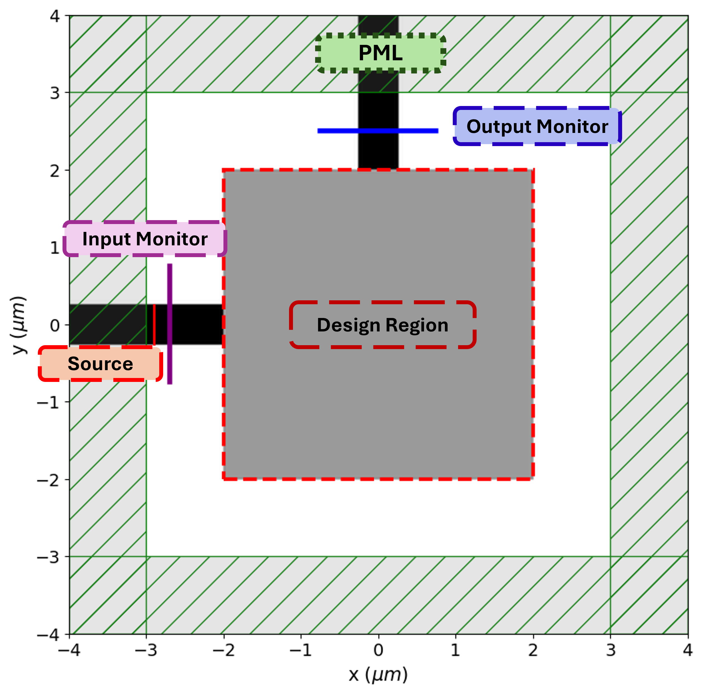

<h1>90° 矽光子彎曲波導 結構反向設計與 FDTD 模擬教學</h1>

  <strong>
    使用 Meep 有限差分時域法（FDTD）評估彎曲波導的 TE₀ 模態傳輸， 
    並比較 2D Fourier Basis、Gaussian Upsampling 與 β-VAE 三種結構編碼方法。
  </strong>

  <a href="#概述">概述</a> ·
  <a href="#主要內容">主要內容</a> ·
  <a href="#方法">方法</a> ·
  <a href="#模擬設定">模擬設定</a> ·
  <a href="#結果">結果</a> ·
  <a href="#教學">教學</a> ·
  <a href="#執行方式">執行方式</a> ·
  <a href="#引用">引用</a>

  
  
  
  
  

## 概述

彎曲波導是矽光子積體電路（Silicon Photonics Integrated Circuits）中常見的被動光學元件，主要功能是改變光訊號的傳播方向。彎曲區域的幾何形狀會影響導波模態的侷限程度、輻射損耗及輸出端的模態傳輸，因此如何在有限的設計區域內找到具有良好傳輸特性的結構，是矽光子元件設計的重要課題。

本專案以 Meep 開源電磁模擬套件進行有限差分時域法（Finite-Difference Time-Domain, FDTD）模擬，建立輸入波導位於 **−X 側、光沿 +X 方向入射**，並由輸出波導沿 +Y 方向導出的 90° 彎曲波導模型。設計區域位於中央，透過 TE₀ 模態激發與模態係數監測，評估候選結構的穿透率。

為了探索不同的結構表示方式，本專案實作三種編碼方法：**2D Fourier Basis、Gaussian Upsampling（GU）及 β-Variational Autoencoder（β-VAE）**。各方法將低維度的最佳化變數轉換成 Meep 可用的材料分佈，再由電磁模擬計算穿透率。

最佳化流程以因子分解機（Factorization Machine, FM）建立代理模型，將模型轉換為二次無約束二元最佳化（Quadratic Unconstrained Binary Optimization, QUBO）問題，並使用模擬退火（Simulated Annealing, SA）搜尋候選解。部分程式亦保留 D-Wave 量子退火（Quantum Annealing, QA）的介面。

> **注意：** 本專案目前採用二維（2D）Meep 模型，材料區域在垂直於模擬平面的方向視為無限延伸（mp.inf）。因此，結果屬於二維模型下的數值模擬，不應直接視為具有有限矽核心厚度的完整 3D SOI 元件結果；本專案亦未進行實際元件製作或量測。

## 主要內容

- **90° 彎曲波導 FDTD 模型：** 建立中央 4 µm × 4 µm 的設計區域，搭配左右／上下延伸的固定波導臂，以 Meep 評估 TE₀ 模態的輸入與輸出功率。
- **三種結構編碼方法：** 分別以 Fourier 基底、Gaussian 平滑與投影，以及 β-VAE 潛在空間表示設計結構，提供不同的設計空間參數化方式。
- **FM-QUBO 最佳化流程：** 利用已完成 FDTD 評估的樣本訓練 FM 代理模型，轉換成 QUBO 後以 SA 搜尋新候選解，再由 Meep 進行真實物理評估。
- **MPI 平行模擬：** 使用 MPI 將不同候選結構的 FDTD 工作分派給多個 Worker，降低大量候選結構評估所需的時間。
- **Notebook 與 Python 程式：** 每種編碼方法均提供 Jupyter Notebook 與可透過命令列執行的 Python 程式。

## 方法

### 1. 整體最佳化流程

本專案的三種編碼方法具有不同的結構表示方式，但都以 Meep FDTD 模擬作為候選結構的物理評估工具。整體流程如下：

~~~mermaid
flowchart TD
    A["產生初始設計變數"] --> B["結構編碼與幾何解碼"]
    B --> C["Meep FDTD 模擬"]
    C --> D["計算 TE₀ 模態穿透率"]
    D --> E["建立並更新訓練資料集"]
    E --> F["訓練 Factorization Machine"]
    F --> G["轉換為 QUBO"]
    G --> H["SA 搜尋候選解"]
    H --> B
    D --> I["最佳結構與結果分析"]
~~~

每一輪最佳化中，FM 會根據目前已評估的設計樣本學習設計變數與穿透率之間的關係。模型參數可轉換為 QUBO，交由 SA 搜尋低能量候選解。候選解經結構解碼後，再由 Meep 執行 FDTD 模擬，將新的穿透率資料加入資料集，供下一輪代理模型訓練使用。

本專案以 **提高 TE₀ 模態穿透率**為目標。程式內部依不同實作使用穿透率或其負值作為最佳化目標，閱讀各程式時應以實際的 FOM 定義為準。

### 2. 2D Fourier Basis

  <strong>以二維正弦基底組合表示設計區域</strong>

2D Fourier Basis 將二元設計變數對應至不同空間頻率的正弦基底。程式依照各基底係數是否啟用，累加形成二維場分佈，再透過閾值將結果轉換為二元材料結構。

主要設定為 10 × 10 組 Fourier modes，共 **100 個二元設計變數**。此方法以低維度的基底組合表示高解析度設計區域，可用來研究基底數量與結構表示能力對最佳化結果的影響。

程式位置：

- [2D_Fourier_10x10.ipynb](Tutorial/2D_Fourier_Basis/2D_Fourier_10x10.ipynb)
- [2D_Fourier_10x10.py](Tutorial/2D_Fourier_Basis/2D_Fourier_10x10.py)

### 3. Gaussian Upsampling（GU）

  <strong>以 Gaussian 平滑與 Tanh 投影建立連續材料分佈</strong>

Gaussian Upsampling 將低解析度二元變數重組為二維網格，先進行 Gaussian convolution，使相鄰像素之間的材料分佈平滑，再透過 Tanh projection 將密度值推向接近 0 或 1 的區域，最後映射至 Meep 的 MaterialGrid。

目前提供的程式以 10 × 10 網格作為設計變數，共 **100 個二元變數**。Gaussian kernel 使用 5 × 5 尺寸、標準差 σ = 1.0；Tanh 投影參數為 β = 50、η = 0.5。

程式位置：

- [WG_GU_1000_10x10.ipynb](Tutorial/Gaussian_Upsampling/WG_GU_1000_10x10.ipynb)
- [WG_GU_1000_10x10.py](Tutorial/Gaussian_Upsampling/WG_GU_1000_10x10.py)

### 4. β-Variational Autoencoder（β-VAE）

  <strong>以生成式模型學習設計結構的低維潛在表示</strong>

β-VAE 方法先以合成的二維二元結構建立訓練資料，再訓練 VAE 學習結構分佈與低維度潛在表示。最佳化時，FM 代理模型直接以潛在變數為輸入，經 QUBO 與 SA 搜尋候選解，再由 β-VAE Decoder 將潛在表示還原為設計區域，交由 Meep 評估。

目前程式使用 64 × 64 的結構影像、100 個潛在類別變數（每個變數具有 2 個類別），並以 10,000 組合成結構訓練 VAE。Decoder 輸出後另包含 Gaussian smoothing 與 Tanh projection，以改善生成結構的邊界分佈。

程式位置：

- [bVAE_gu.ipynb](Tutorial/beta_VAE/bVAE_gu.ipynb)
- [bVAE_gu.py](Tutorial/beta_VAE/bVAE_gu.py)

## 模擬設定

以下參數整理自目前三種 Python 程式共用的 Meep 模型設定。

| 參數 | 數值 | 說明 |
|---|---:|---|
| 模擬維度 | 2D | 二維 FDTD 模型 |
| 設計區域 | 4.0 × 4.0 µm² | 中央可最佳化區域 |
| WG_WIDTH | 0.5 µm | 輸入與輸出波導寬度 |
| WG_LENGTH | 1.0 µm | 固定波導臂長度參數 |
| DPML | 1.0 µm | PML 吸收層厚度 |
| SX、SY | 8.0 µm | 模擬計算區域尺寸 |
| N_SI | 3.48 | 矽材料折射率 |
| N_SIO2 | 1.44 | 二氧化矽材料折射率 |
| WL_CEN | 1.55 µm | 中心波長 |
| FCEN | 1 / 1.55 | 中心頻率 |
| DF | 0.1 × FCEN | Gaussian source 頻寬參數 |
| NFREQ | 1 | 模態監測頻率點數 |
| RESOLUTION | 40 | 每 µm 的網格數 |

長度單位為 µm。上述折射率採用常數近似，未包含材料色散模型。模擬中以 EigenModeSource 激發輸入導波模態，並透過模態監測器取得輸入與輸出端的模態係數。程式以 Ez 場分量作為主要場分佈與衰減觀察量；TE₀ 的偏振命名應搭配本專案的二維模擬平面及場分量慣例理解。

### 最佳化參數

下表為各程式目前的預設參數，主要供重現與比較程式設定使用；不同方法的資料量、設計變數定義與模型訓練流程並不完全相同，因此不應只憑表格中的數字直接判定方法優劣。

<b>2D Fourier Basis 設定</b>（點擊展開）

| 類別 | 參數 | 數值 |
|---|---|---:|
| 設計空間 | Fourier modes | 10 × 10 |
| 設計空間 | 二元變數數量 | 100 |
| 初始資料集 | 樣本數 | 1,000 |
| 最佳化 | 迭代次數 | 100 |
| 最佳化 | 每輪新增候選數 | 30 |
| FM 代理模型 | 因數維度 K | 10 |
| FM 代理模型 | 訓練 epochs | 1,000 |
| FM 代理模型 | Learning rate | 0.001 |
| SA | num_reads | 10,000 |
| SA | num_sweeps | 1,000 |
| 預設取樣器 | SAMPLER_TYPE | SA |

<b>Gaussian Upsampling 設定</b>（點擊展開）

| 類別 | 參數 | 數值 |
|---|---|---:|
| 設計空間 | 二元網格 | 10 × 10 |
| 設計空間 | 二元變數數量 | 100 |
| Gaussian kernel | Kernel size | 5 × 5 |
| Gaussian kernel | 標準差 σ | 1.0 |
| Tanh projection | β | 50 |
| Tanh projection | η | 0.5 |
| 初始資料集 | 樣本數 | 1,000 |
| 最佳化 | 迭代次數 | 100 |
| 最佳化 | 每輪新增候選數 | 30 |
| FM 代理模型 | 因數維度 K | 8 |
| FM 代理模型 | 訓練 epochs | 1,000 |
| FM 代理模型 | Learning rate | 0.001 |
| SA | num_reads | 1,500 |
| SA | num_sweeps | 1,000 |
| 預設取樣器 | SAMPLER_TYPE | SA |

<b>β-VAE 設定</b>（點擊展開）

| 類別 | 參數 | 數值 |
|---|---|---:|
| 輸入結構 | 影像尺寸 | 64 × 64 |
| VAE | 隱藏層 | 512、256 |
| VAE | 潛在變數數量 N | 100 |
| VAE | 每個潛在變數類別數 K | 2 |
| VAE 訓練 | 合成資料數量 | 10,000 |
| VAE 訓練 | Batch size | 64 |
| VAE 訓練 | Epochs | 30 |
| VAE 訓練 | Learning rate | 0.001 |
| 初始模擬資料 | 樣本數 | 2,000 |
| 最佳化 | 迭代次數 | 200 |
| 最佳化 | 每輪新增候選數 | 30 |
| FM 代理模型 | 因數維度 K | 10 |
| FM 代理模型 | 訓練 epochs | 1,000 |
| SA | num_reads | 2,000 |
| SA | num_sweeps | 1,000 |

## 結果

目前 Repository 以三種方法的教學 Notebook、Python 模擬程式及共用模組為主，並未在首頁固定列出單一最佳穿透率或宣稱某種編碼方式一定優於其他方法。執行程式後，會依各方法的設定輸出最佳結構、最佳化歷程、場分佈圖與實驗紀錄。

建議比較不同方法時，至少確認以下條件一致：

- Meep 模擬區域、材料折射率、波導寬度與中心波長。
- 輸入模態、輸出模態及穿透率的計算方式。
- FDTD resolution、PML 厚度及模擬停止條件。
- 候選結構評估總數與隨機種子。
- FM 訓練設定、退火取樣設定與實際模擬時間。

目前三種程式的預設資料量與最佳化預算不同，若要進行公平的效能比較，建議另行統一模擬預算並記錄隨機種子。

**所有結果皆為 Meep 二維 FDTD 數值模擬結果，並非實際元件量測。** SA 與初始樣本具有隨機性，每次執行不保證得到相同結果；退火搜尋亦不保證找到全域最佳解。本文所稱的最佳結構，應理解為該次執行中已評估樣本的最佳解（best-found solution）。

### README 圖片規劃

為了讓首頁更容易理解研究流程，建議將整理後的圖片集中放在根目錄的 `assets/`。以下是依照目前三套程式的實際輸出內容規劃的圖片清單；這些是**建議放入的素材名稱**，不是目前已經存在的圖片。請將程式執行後的結果複製到 `assets/`，再取消對應的 Markdown 圖片註解即可。

| 建議檔名 | 圖片內容 | 建議來源／製作方式 | README 用途 |
|---|---|---|---|
| `bend_geometry.png` | 90° 彎曲波導配置、4 × 4 µm² 設計區域、輸入與輸出方向、PML | 依 Meep 幾何參數繪製示意圖 | 首頁總覽，讓讀者先理解元件 |
| `optimization_flow.png` | 編碼 → Meep FDTD → FoM → FM → QUBO → SA → 更新資料集 | 依 README 的流程圖整理成高解析度圖片；也可保留 Mermaid 流程圖 | 說明整體最佳化架構 |
| `fourier_encoding.png` | Fourier 基底組合及二值化後的結構 | 可由 Fourier Notebook 擷取／整理 | Fourier 方法介紹 |
| `gu_encoding.png` | 低解析度二元網格、Gaussian 平滑、Tanh 投影與最終結構 | 依 GU Notebook 的編碼步驟製作流程圖 | GU 方法介紹 |
| `bvae_encoding.png` | 合成訓練樣本、Encoder／潛在變數／Decoder、64 × 64 輸出 | 依 β-VAE Notebook 與模型架構繪製 | β-VAE 方法介紹 |
| `best_structure_fourier.png` | Fourier 最佳結構與材料邊界 | `final_analysis_TE0_field.png` 或 `Smoothed_Binary_Structure.png` 擷取設計區域 | 比較最佳結構 |
| `best_structure_gu.png` | GU 最佳二元配置及平滑後結構 | `best_config_10x10.png`（實際尺寸依設定）及 `Smoothed_Binary_Structure.png` | 比較最佳結構 |
| `best_structure_bvae.png` | β-VAE 最佳潛在表示解碼出的 64 × 64 結構 | 由 `best_structure_64x64.npy` 繪圖；程式另存 `best_latent_10x10.png` | 比較最佳結構 |
| `field_fourier.png` | Fourier 最佳結構的 Ez 場強度分佈 | `final_analysis_TE0_field.png` | 展示電磁場傳播 |
| `field_gu.png` | GU 最佳結構的場強度分佈 | `Optimized_Final_Structure.png` | 展示電磁場傳播 |
| `field_bvae.png` | β-VAE 最佳結構的 Ez 場分佈 | `final_field.png` | 展示電磁場傳播 |
| `fom_comparison.png` | 三種方法最佳 FoM／穿透率隨迭代變化 | 整合三次實驗的 `fom_evolution.png`，統一座標與定義 | 比較收斂情形 |
| `trajectory_comparison.png` | 三種方法所有候選樣本的穿透率分佈 | 整合各方法的 `transmission_trajectory.png` | 比較搜尋過程 |
| `runtime_comparison.png` | 三種方法的模擬、FM 訓練與退火時間比較 | 整理各程式的時間紀錄；需先確認統計欄位定義一致 | 比較計算成本 |

**建議優先順序：** 第一階段先準備 `bend_geometry.png`、三張最佳結構圖、三張場分佈圖與三種方法的 FoM 收斂比較；第二階段再補編碼流程圖與計算時間比較。跨方法比較圖應使用相同的 FoM 定義、評估預算與座標尺度，避免造成不公平的視覺比較。

圖片檔案建議使用 PNG（結果圖）或 SVG（向量示意圖），並保留原始模擬輸出，不要只保留裁切後的 README 版本。

<!--
圖片完成後，可在適當章節插入，例如：

  
   <em>圖 1. 90° 彎曲波導幾何、設計區域及輸入輸出方向。</em>

-->

## 教學

本 Repository 依照結構編碼方法分成三個獨立的 Tutorial。每個方法皆提供 Jupyter Notebook 與 Python 程式，Notebook 適合逐步閱讀與理解流程，Python 程式則適合透過 MPI 執行完整最佳化。

### 1. 2D Fourier Basis Tutorial

| 檔案 | 說明 |
|---|---|
| [2D_Fourier_10x10.ipynb](Tutorial/2D_Fourier_Basis/2D_Fourier_10x10.ipynb) | Fourier 基底編碼與彎曲波導設計教學 |
| [2D_Fourier_10x10.py](Tutorial/2D_Fourier_Basis/2D_Fourier_10x10.py) | 2D Fourier Basis 最佳化與 Meep 模擬程式 |
| factorization_machine.py | FM 代理模型實作 |

### 2. Gaussian Upsampling Tutorial

| 檔案 | 說明 |
|---|---|
| [WG_GU_1000_10x10.ipynb](Tutorial/Gaussian_Upsampling/WG_GU_1000_10x10.ipynb) | Gaussian Upsampling 結構編碼教學 |
| [WG_GU_1000_10x10.py](Tutorial/Gaussian_Upsampling/WG_GU_1000_10x10.py) | GU 最佳化與 Meep 模擬程式 |
| factorization_machine.py | FM 代理模型實作 |

### 3. β-VAE Tutorial

| 檔案 | 說明 |
|---|---|
| [bVAE_gu.ipynb](Tutorial/beta_VAE/bVAE_gu.ipynb) | β-VAE 結構生成與潛在空間最佳化教學 |
| [bVAE_gu.py](Tutorial/beta_VAE/bVAE_gu.py) | β-VAE 訓練、FM 最佳化與 Meep 模擬程式 |
| factorization_machine.py | FM 代理模型實作 |

### 專案結構

~~~text
Bend_Waveguide_Tutorial/
├── README.md
├── TUTORIAL.md
├── assets/
│   └── .gitkeep
├── LICENSE
├── Tutorial/
│   ├── 2D_Fourier_Basis/
│   │   ├── 2D_Fourier_10x10.ipynb
│   │   ├── 2D_Fourier_10x10.py
│   │   └── factorization_machine.py
│   ├── Gaussian_Upsampling/
│   │   ├── WG_GU_1000_10x10.ipynb
│   │   ├── WG_GU_1000_10x10.py
│   │   └── factorization_machine.py
│   └── beta_VAE/
│       ├── bVAE_gu.ipynb
│       ├── bVAE_gu.py
│       └── factorization_machine.py
└── shared_modules/
    ├── __init__.py
    ├── factorization_machine.py
    └── meep_utils.py
~~~

## 執行方式

### 環境需求

程式主要使用以下 Python 套件：

| 套件 | 用途 |
|---|---|
| Meep / pymeep | FDTD 電磁模擬 |
| NumPy、SciPy | 數值運算與濾波 |
| Matplotlib | 結構及模擬結果視覺化 |
| PyTorch | FM 與 β-VAE 模型訓練 |
| mpi4py、MPI | 平行分派 FDTD 模擬工作 |
| dimod | 建立 QUBO / Binary Quadratic Model |
| dwave-samplers | 模擬退火取樣 |
| dwave-system | 選用；連接 D-Wave 量子退火器 |

本 Repository 目前未提供固定版本的 requirements.txt 或 Conda environment 檔案。請依照使用環境安裝相容的 Meep、MPI 與 Python 套件版本。Meep 安裝方式請參考官方文件：[Meep Installation Guide](https://meep.readthedocs.io/en/latest/Installation/)。

### 執行 Gaussian Upsampling 範例

在 Repository 根目錄執行：

~~~bash
cd Tutorial/Gaussian_Upsampling
mpirun -np 31 python WG_GU_1000_10x10.py --name bend_gu
~~~

### 執行 2D Fourier Basis 範例

~~~bash
cd Tutorial/2D_Fourier_Basis
mpirun -np 31 python 2D_Fourier_10x10.py --name bend_fourier
~~~

### 執行 β-VAE 範例

~~~bash
cd Tutorial/beta_VAE
mpirun -np 31 python bVAE_gu.py
~~~

上述 -np 31 代表啟動 31 個 MPI processes，通常包含 1 個 Master 與 30 個 Workers。請依照實際 CPU 核心數、記憶體及可用運算資源調整，不應在未評估資源的情況下任意提高行程數。

各程式的結果輸出位置依程式而異，包含 Fourier 的 Results/、GU 的 Results_Bend/，以及 β-VAE 的時間戳記結果資料夾。實際路徑以執行時的工作目錄與程式輸出訊息為準。

更完整的模型說明、執行流程與注意事項，請參閱 [TUTORIAL.md](TUTORIAL.md)。

## 限制與注意事項

1. **二維模型限制：** 目前模型使用 mp.inf 描述垂直於模擬平面的方向，未完整描述有限厚度 SOI 波導的垂直侷限。
2. **材料近似：** 矽與二氧化矽使用固定折射率，未納入色散、製程誤差或材料吸收等因素。
3. **單頻監測：** 目前共用設定使用 NFREQ = 1，因此不應將單一中心波長的模擬結果解讀為完整連續頻譜。
4. **隨機最佳化：** 初始樣本與 SA 搜尋具有隨機性，結果可能因執行次數、隨機種子及超參數不同而改變。
5. **最佳解定義：** 最佳結構代表目前已評估樣本中的 best-found solution，不保證是全域最佳解。
6. **量子退火設定：** 只有具備相應 D-Wave 套件、帳戶憑證與可用 Solver 時，才能使用程式中對應的 QA 路徑；預設設定以 SA 為主。

## 引用

本專案使用以下開源工具與文件：

- **Meep：** [Meep Documentation](https://meep.readthedocs.io/en/latest/)
- **Meep Eigenmode Source：** [Eigenmode Source Tutorial](https://meep.readthedocs.io/en/latest/Python_Tutorials/Eigenmode_Source/)
- **D-Wave Ocean：** [D-Wave Ocean Documentation](https://docs.dwavequantum.com/en/latest/ocean/index.html)
- **PyTorch：** [PyTorch Documentation](https://pytorch.org/docs/stable/index.html)

若使用本 Repository 的程式或方法，請引用本 Repository，並依照實際使用的編碼方法、程式版本及模擬設定說明研究流程。

## 授權

本專案採用 [MIT License](LICENSE)。
